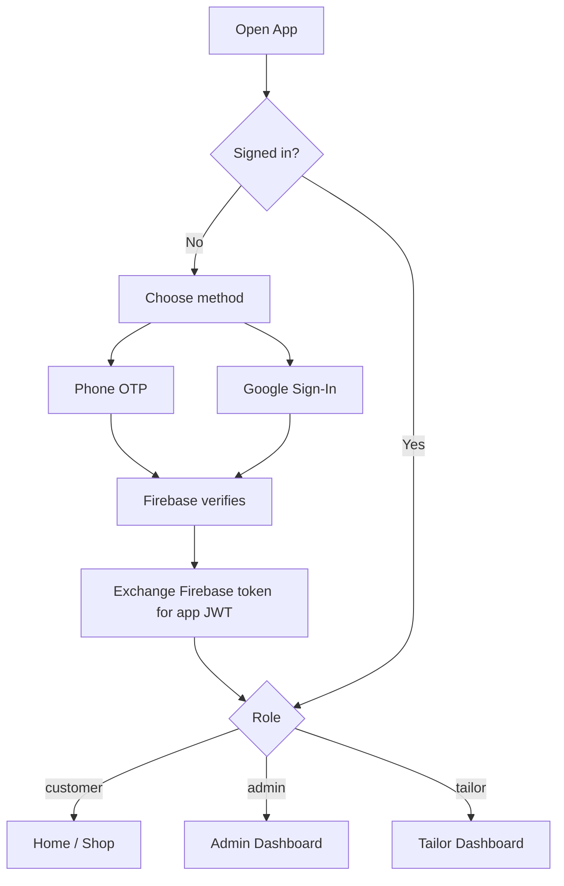
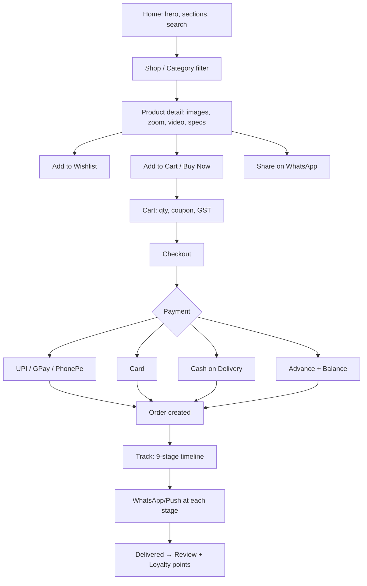
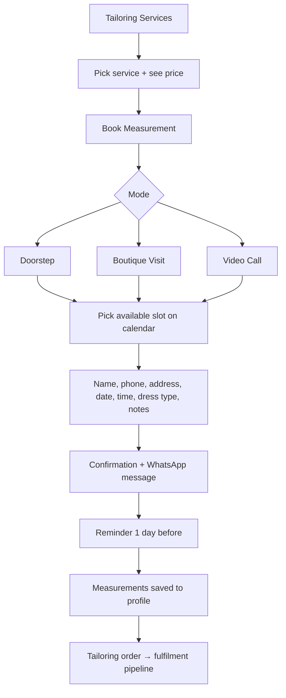
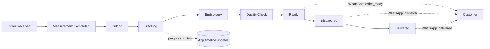
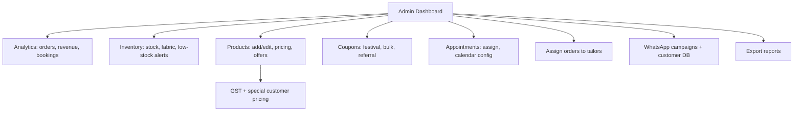
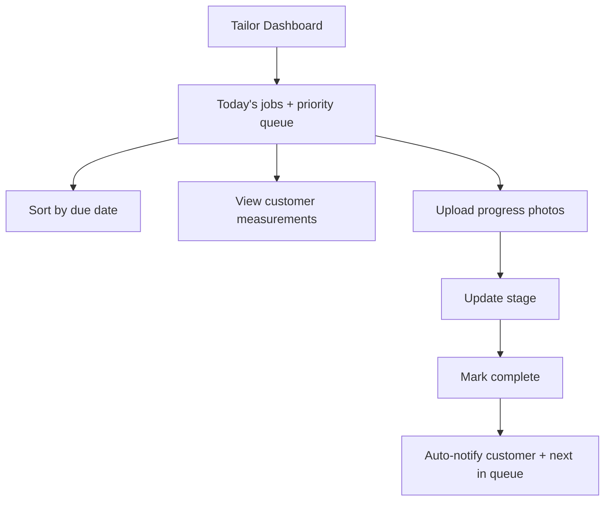
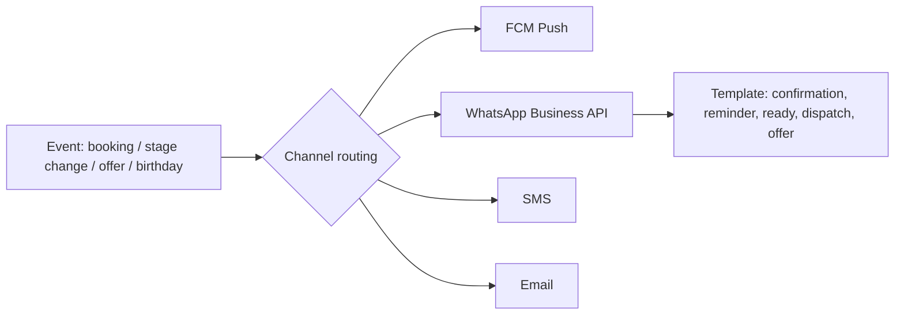

# Thulya — User Flow Diagrams

Three roles: **Customer**, **Boutique Admin**, **Tailor/Master**. Diagrams below are
Mermaid — they render on GitHub and in the Artifact preview.

---

## 1. Authentication (all roles)

## 2. Customer — Browse to Delivery

## 3. Customer — Tailoring + Measurement

## 4. Order fulfilment pipeline (Admin + Tailor)

## 5. Boutique Admin

## 6. Tailor / Master

## 7. Notification engine (cross-cutting)

---

### Screen inventory (Flutter)
`Splash → Auth → Home → Search → Category → Product Detail → Cart → Checkout → Payment →
Order Success → Track Order → Tailoring → Book Measurement → Calendar → Customer Dashboard
(Orders, Measurements, Wishlist, Appointments, Invoices, Addresses, Loyalty) → Gallery →
Offers → Notifications → Profile/Settings (Dark Mode)`.

Admin & Tailor run as the **React + Material UI** web panel and the role-gated Flutter web build.
